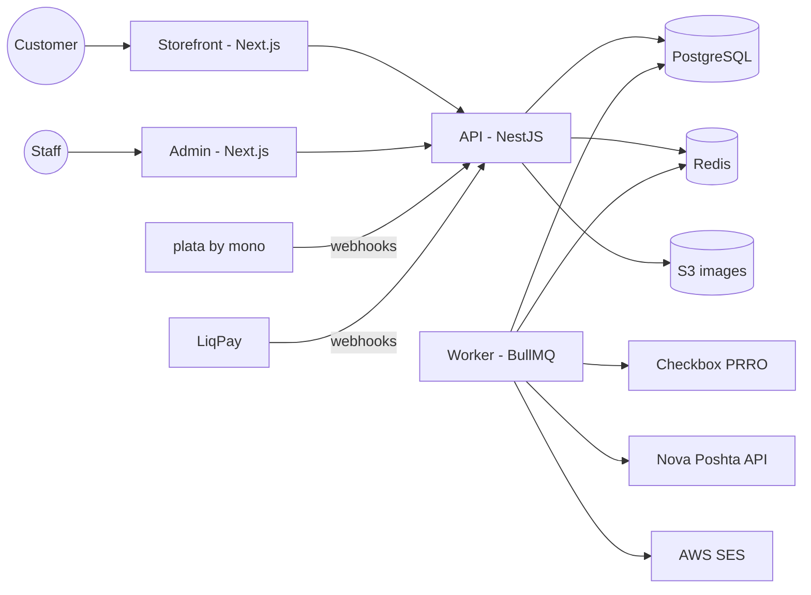
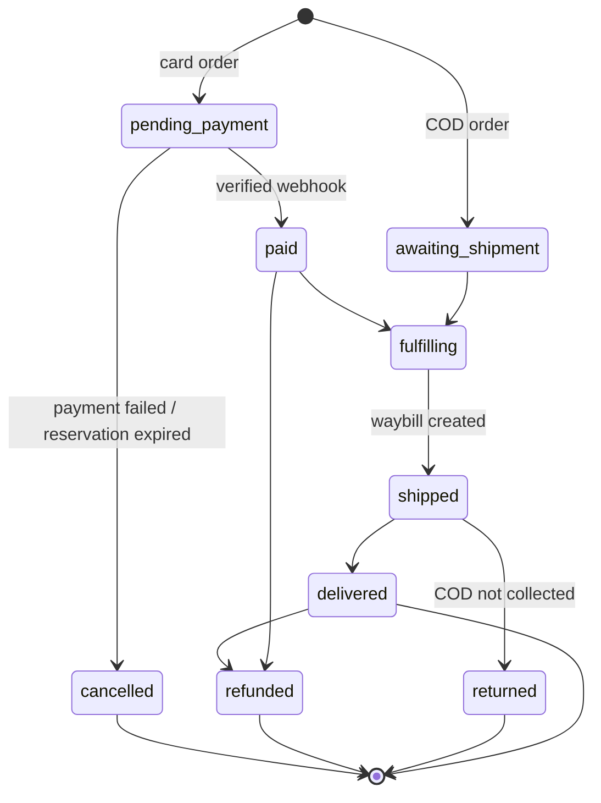

# Project Brief

Living document. Last updated: November 2026.
Rules for day-to-day work are in `CLAUDE.md`. Individual decisions are recorded in `docs/adr/`.

## 1. Purpose

A full-featured online shop for the Ukrainian market, built from scratch to production
standards. The project doubles as a portfolio piece that will be reviewed by senior
developers, so the process (planning, PRs, CI, documentation) matters as much as the code.

### Goals

- Correct handling of money, stock, and payments under concurrency and failure.
- Compliance with Ukrainian requirements: fiscal receipts (PRRO via Checkbox), local
  payment providers, Nova Poshta delivery, cash on delivery, Ukrainian localization.
- A clear, defensible architecture with every major choice documented in an ADR.
- Automated quality: linting, type checking, unit/integration/E2E tests, security scanning,
  and deployment through CI.
- Production deployment on AWS, fully defined in Terraform.

### Non-goals (for now)

- Microservices or Kubernetes in production (see section 4).
- Marketplace features (multiple sellers), subscriptions, or loyalty programs.
- A native mobile app (the API is designed so one could be added later).

### Future extensions (documented, not planned)

- **Subscriptions:** start with provider-managed subscriptions (e.g. LiqPay's built-in
  recurring payments) and react to webhooks. Only if billing rules outgrow that, move to
  merchant-initiated charges with saved card tokens, scheduled through BullMQ, with an
  idempotency key per billing period, a capped retry policy (e.g. retry after 1 and 3 days,
  notify the customer, then pause), explicit consent at signup, and easy cancellation.
- **Bulk waybill creation** for many orders at once, processed through the queue.
- **More carriers** (Ukrposhta, Meest) behind the existing `ShippingProvider` interface.
- **Meilisearch** if Postgres search stops meeting measured needs.

## 2. Users and core flows

**Customers** browse and search the catalog, manage a cart (as a guest or signed in),
check out with card payment or cash on delivery, choose a Nova Poshta branch or parcel
locker, receive a fiscal receipt by email, and track orders in their account.

**Staff (admin)** manage products, variants, categories, stock, and discount codes; process
orders through their lifecycle; create Nova Poshta waybills; issue refunds; and view basic
sales reports.

## 3. Architecture overview

A **modular monolith**: one NestJS API with strict module boundaries, one background worker
sharing the same codebase, and two Next.js frontends.



### API modules

catalog, cart, checkout, orders, payments, inventory, users, shipping, fiscalization,
notifications. Modules communicate only through exported services or domain events, never
through each other's tables.

### Why NestJS and Next.js together

NestJS is the backend: all business logic, database access, payments, webhooks, and
background jobs. Next.js is the frontend: server-rendered pages for speed and SEO. Business
logic stays in one backend shared by both frontends (and any future client), long-running
workers live outside the web framework, and the backend can be tested and scaled
independently. Frontends only render and call the API through the generated typed client.

### Repository layout

```
shop/
├── apps/
│   ├── api/              # NestJS API + BullMQ worker
│   ├── storefront/       # Next.js (customers)
│   └── admin/            # Next.js (staff)
├── packages/
│   ├── contracts/        # Zod schemas, OpenAPI generation
│   ├── api-client/       # Generated typed client
│   ├── ui/               # Shared components
│   ├── config-eslint/
│   └── config-ts/
├── infra/                # Terraform (optional k8s/ bonus later)
├── docs/
│   ├── PROJECT_BRIEF.md
│   ├── adr/
│   ├── vendor/           # Official API docs: monobank, LiqPay, Checkbox, Nova Poshta
│   ├── runbooks/
│   └── architecture.md
├── .github/              # workflows, PR template, CODEOWNERS
├── .claude/              # Claude Code settings and hooks
├── docker-compose.yml
├── CLAUDE.md
└── README.md
```

## 4. Technology stack and rationale

### Core

| Layer | Choice | Rationale |
|---|---|---|
| Runtime | Node.js 26 LTS | Current LTS line, supported until 2029. Pinned via `.nvmrc` and `engines`. |
| Language | TypeScript, strict | Baseline for professional Node projects. |
| Repo | pnpm workspaces + Turborepo | Shared contracts and types across apps; cached builds. |
| Backend | NestJS (Fastify adapter) | Enforced structure (modules, DI, guards, pipes) keeps code consistent across many AI-assisted sessions. DI makes provider interfaces and test fakes natural. Fastify removes the performance concern. |
| Database | PostgreSQL | Transactional DDL (failed migrations roll back fully), JSONB for category-specific product attributes, constraints that enforce rules in the database, strong search (full-text + `pg_trgm`). |
| ORM | Drizzle (+ drizzle-zod) | Typed access to more Postgres features: row locking for checkout, full-text and JSON queries for search, grouping and joins for admin reports, without falling back to raw SQL. Predictable one-to-one mapping to SQL; no code generation step. |
| Cache, sessions, queues | Redis 7.x + BullMQ | Industry standard. Runs background jobs, stores sessions, provides shared rate limiting across instances, and caches selected lookups. Valkey was considered (cheaper on ElastiCache, protocol-compatible); Redis chosen for recognition and ecosystem. |
| Contracts | Zod -> OpenAPI -> generated client | One source of truth for request/response shapes across API and frontends. API docs via Scalar. |
| Auth | Session cookies in Redis, Argon2, RBAC | Safer than browser-stored tokens for a web shop; instant revocation. Better Auth is an option. |
| Search | Postgres full-text + `pg_trgm` | Typo-tolerant search without extra infrastructure. Needs a Ukrainian dictionary setup. Meilisearch only if measured need arises. |

### Frontend

| Area | Choice |
|---|---|
| Storefront | Next.js App Router, Tailwind, shadcn/ui; server components and ISR for catalog pages |
| Admin | Next.js with TanStack Table and TanStack Query |
| Forms | React Hook Form with shared Zod schemas |
| i18n | next-intl; `uk` default, `en` second |
| Email templates | React Email |

### Alternatives considered (summary)

- **Express / Fastify alone / Hono / AdonisJS** instead of NestJS: less enforced structure,
  or smaller ecosystem.
- **MySQL** instead of PostgreSQL: viable, but weaker for transactional migrations, JSON
  attributes, and flexible search.
- **Prisma** instead of Drizzle: easier learning curve, polished migrations, nested writes;
  rejected because checkout locking, advanced search, and reporting would require raw SQL.
- **Valkey** instead of Redis: cheaper on AWS and fully compatible; Redis kept as the
  recognized standard.
- **Kubernetes (EKS)**: same orchestration benefits as ECS Fargate with far more operational
  overhead and a fixed control-plane cost. Not justified at this scale.

## 5. Ukraine-specific integrations

| Need | Choice | Notes |
|---|---|---|
| Card payments (primary) | plata by mono | In-house typed client from official docs (no official Node SDK). ECDSA-signed webhooks verified against the published public key. Supports holds. |
| Card payments (second) | LiqPay | Second adapter proves the `PaymentProvider` abstraction. Own client; signature scheme per LiqPay docs. |
| Cash on delivery | Order state machine branch | COD orders skip `pending_payment`; paid on parcel collection. Needs fraud limits (phone verification, per-customer limits, shorter reservations). |
| Fiscal receipts | Checkbox API | Legally required for card payments. Queued, idempotent, retryable jobs. Sale receipts on payment, return receipts on refund. Confirm obligations with an accountant. |
| Delivery | Nova Poshta API | Branch/locker directory cached in Postgres and synced nightly; waybill (TTN) creation from admin; tracking via polling job. Behind `ShippingProvider` so Ukrposhta/Meest can follow. |
| Currency & formatting | UAH in kopiykas | `Intl.NumberFormat('uk-UA')` for display; currency field kept for future EUR/USD. |
| Phones | libphonenumber-js | Normalized to E.164 (`+380...`); required by Nova Poshta. |
| Legal pages | Public offer, terms, privacy policy | Required by acquirers before merchant approval; reflect Ukrainian personal data law. |

Acquirers review the live site before approving a merchant account, so start onboarding in
parallel with development. Sandboxes are sufficient for building and demoing.

## 6. Domain model and key engineering decisions

### Core entities

users, addresses, sessions; categories, products, product_variants (SKU, price, stock,
JSONB attributes), product_images; carts, cart_items; orders, order_items (with price and
name snapshots); payments, payment_events (processed webhook IDs); inventory_reservations;
discount_codes; shipments, nova_poshta_cities, nova_poshta_branches; fiscal_receipts;
outbox_events; audit_log.

The full ERD lives in `docs/architecture.md` (Mermaid) and is produced in Phase 1.

### Order state machine



Transitions are enforced in one place in the orders module. Exact states may be refined
in the Phase 1 ADR.

### Decisions reviewers will probe

- **Overselling:** stock is reserved in a transaction with row locking; reservations expire
  through a scheduled job.
- **Money:** integers in kopiykas plus currency code; totals always computed server-side.
- **Price changes:** order items snapshot prices, so catalog edits never alter past orders.
- **Duplicate or late webhooks:** signature verification, stored event IDs, and stale-update
  checks make processing idempotent and order-safe.
- **Lost side effects:** the transactional outbox guarantees emails, receipts, and stock
  updates happen even if the process crashes mid-flow.
- **Lost webhooks:** a scheduled reconciliation job checks orders stuck in `pending_payment`
  directly with the provider.
- **Failed payments:** never retried automatically. The customer decides whether to try again,
  use another card, or switch to cash on delivery.
- **External outages:** Checkbox, Nova Poshta, or SES failures are retried by queued jobs and
  never block checkout. The order is recorded first and follow-up work completes afterward
  (eventual consistency).
- **Direct vs. queued:** if a person is waiting for the result (payment link, a single
  waybill from the admin panel), the API calls the service directly; if the work is a
  consequence of something that already happened (receipts, emails, tracking, directory
  sync), it goes through the queue. Full list in `CLAUDE.md`.
- **Scaling:** stateless API, sessions in Redis, horizontal scaling on ECS, read replicas
  if needed.

## 7. Infrastructure (AWS, eu-central-1)

| Need | Service |
|---|---|
| Containers | ECS on Fargate: api, worker, storefront, admin as separate services |
| Image registry | ECR |
| Database | RDS for PostgreSQL with automated backups and point-in-time recovery |
| Cache and queues | ElastiCache for Redis OSS (7.x) |
| Product images | S3 + CloudFront, presigned uploads |
| Email | SES (domain verification: SPF, DKIM, DMARC; production access request) |
| Secrets | Secrets Manager |
| Traffic and TLS | ALB, Route 53, ACM |
| Protection | AWS WAF |
| Observability | CloudWatch, OpenTelemetry via AWS Distro collector, Pino logs, Sentry |
| Infrastructure as code | Terraform, state in S3 with native locking, modules per concern |

**Why ECS Fargate:** container orchestration without managing servers. Lambda fits poorly
with persistent DB connections and long-running workers; EKS adds cost and operational
overhead; EC2 means patching servers.

**Why RDS over Aurora:** proportionate cost at this scale; migration path exists.

**Security:** containers in private subnets, only the load balancer is public;
least-privilege IAM role per service; secrets injected at runtime; no long-lived AWS keys
(GitHub Actions uses OIDC).

**Cost control:** AWS Budgets alerts from day one; staging torn down when unused; NAT
gateway strategy documented in an ADR. Single AWS account with separate environments;
multi-account via Organizations noted as the larger-scale approach.

**Container images:** each app's Dockerfile is added in the PR that creates the app, so CI
builds and scans real images from day one. Multi-stage builds, `turbo prune --docker`,
Next.js standalone output, pinned Node 26 base image, non-root user. API and worker share
one image with different start commands.

**Version consistency:** Postgres and Redis use the same pinned major versions in Docker
Compose, Testcontainers, and AWS (ElastiCache for Redis OSS is on the 7.x line). No `latest`
tags anywhere.

**Kubernetes:** not used in production. An optional Helm chart and local kind/k3d setup in
`infra/k8s/` may be added after the core project is complete.

## 8. Testing strategy

| Level | Tools | Scope |
|---|---|---|
| Unit | Vitest | Services, pure domain logic, state machine, signature verification |
| Integration | Supertest + Testcontainers | Every endpoint against real Postgres and Redis, including authorization failures |
| External APIs | MSW / nock + signed webhook simulator | monobank, LiqPay, Checkbox, Nova Poshta |
| End-to-end | Playwright + axe | Browse -> cart -> checkout -> order visible in admin; accessibility checks |
| Load | k6 | Catalog and checkout endpoints; results documented |

Critical scenarios with dedicated tests: concurrent purchase of the last item, duplicate
webhooks, payment failure, reservation expiry, Checkbox outage with later retry, COD expiry,
refund producing a return receipt.

Caching is added only where measured. At least one real case (e.g. Nova Poshta branch
lookups or the category menu) is cached in Redis, with before/after response times recorded
in the docs.

Coverage thresholds are enforced in CI for core modules (checkout, payments, orders,
inventory), not chased to 100% everywhere.

## 9. Development process

- **Git:** trunk-based, short-lived branches, protected `main`, squash merges, signed commits.
- **Commits:** Conventional Commits enforced by commitlint.
- **PRs:** every change via PR with template (what, why, how tested, screenshots); CI must
  pass; CODEOWNERS.
- **Planning:** GitHub Projects; epics per phase; issues with acceptance criteria; PRs close
  issues.
- **Releases:** semantic-release or Changesets; generated CHANGELOG and tags.
- **Quality tooling:** ESLint (flat config, typescript-eslint), Prettier, Husky + lint-staged.
- **CI/CD (GitHub Actions):** install -> lint -> typecheck -> unit -> integration -> build ->
  Docker build + Trivy scan; `terraform plan` on PRs; on merge deploy to staging with
  migrations as a one-off ECS task; production on tagged releases.
- **Security scanning:** CodeQL, Renovate, Trivy.
- **Local development:** Docker Compose with Postgres and Redis 7.x; Cloudflare Tunnel for
  receiving real sandbox webhooks. Local AWS emulation (S3, SES) is chosen in an ADR when first
  needed: LocalStack now requires an account and auth token, and its free plan is
  non-commercial only.

### Definition of Done

Typed and linted; unit and integration tests; OpenAPI updated; migration included if the
schema changed; docs or ADR updated if behavior or decisions changed; CI green.

### Working with Claude Code

- `CLAUDE.md` holds the rules; this brief holds the context.
- Plan mode for every non-trivial task; one issue per branch per PR; every diff reviewed by
  a human before merging.
- Official vendor docs in `docs/vendor/` so integrations are built from specs, not memory.
- Hooks run lint, typecheck, and tests after edits; permissions block `terraform apply`,
  `terraform destroy`, and destructive AWS commands.
- Orca is used for parallel worktrees once work splits into independent issues (from
  Phase 2 onward); foundation work is sequential.

## 10. Roadmap

### Phase 0 PR order

Each step is its own issue and PR, in this order, because each depends on the previous one:

1. Monorepo and tooling (pnpm, Turborepo, TS configs, ESLint, Prettier, Husky, commitlint,
   Node 26 pinned via `.nvmrc`, `engines`, `packageManager`)
2. Docker Compose for local infrastructure (Postgres, Redis 7.x)
3. CI pipeline, then its checks required by the `main` ruleset
4. NestJS API skeleton (health check, config validation) with its Dockerfile
5. Next.js storefront and admin skeletons, each with its Dockerfile
6. Shared contracts package and initial ADRs

AWS account setup, Terraform state bootstrap, and GitHub OIDC follow once the code
foundation is in place.

### Phases

| Phase | Focus | Key deliverables |
|---|---|---|
| 0. Foundations | Tooling and pipeline | Monorepo, TS/ESLint/Prettier/Husky/commitlint, Docker Compose, CI, branch protection, Renovate/CodeQL, AWS account with MFA and budgets, Terraform state bootstrap, GitHub OIDC, initial ADRs |
| 1. Domain modeling | Data and contracts | ERD, order state machine, Drizzle schema and first migrations, Zod contracts, OpenAPI + Scalar |
| 2. Backend core | Auth and catalog | Sessions, RBAC, rate limiting, catalog CRUD, search, S3 presigned uploads, Problem Details errors, request IDs, config from Secrets Manager |
| 3. Checkout and payments | The hard part | Guest/user carts and merge, stock reservation with locking, mono adapter, LiqPay adapter, idempotent webhooks, outbox, reservation expiry, payment reconciliation job, signed webhook simulator |
| 4. Orders and integrations | Post-purchase | Order management, refunds, discount codes, audit log, Checkbox fiscalization, Nova Poshta waybills and tracking, SES email |
| 5. Storefront | Customer UI | Catalog, product pages, cart, checkout with Nova Poshta picker and payment choice, account, i18n, SEO, accessibility |
| 6. Admin | Staff UI | Dashboard and reports, products, orders, waybills, customers, discounts |
| 7. Hardening | Quality and security | Playwright E2E, coverage thresholds, OWASP review, WAF rules, IAM review, k6 load tests, index tuning, measured Redis caching |
| 8. Deployment | Production | Full Terraform stack, ECS services, migration pipeline, staging and production, alarms, graceful shutdown, health checks |
| 9. Presentation | Polish | README with demo and test credentials, architecture diagrams, notable decisions, runbooks, known limitations |
| Bonus | Optional | Helm chart and local Kubernetes setup |

## 11. Planned ADRs

0001 Modular monolith · 0002 Monorepo with pnpm and Turborepo · 0003 NestJS on Fastify ·
0004 PostgreSQL · 0005 Drizzle over Prisma · 0006 Redis over Valkey · 0007 Session-based
auth · 0008 Payment provider abstraction (mono + LiqPay, in-house clients) ·
0009 Fiscalization via Checkbox · 0010 Nova Poshta and shipping abstraction ·
0011 AWS with ECS Fargate · 0012 Terraform · 0013 No Kubernetes in production ·
0014 NAT and networking strategy

## 12. Open questions

- Legal entity (FOP or LLC) and resulting fiscal obligations: confirm with an accountant.
- Exact product categories and attributes for the seed catalog.
- Whether staging runs continuously or on demand.
- Final domain name (needed for SES verification and acquirer onboarding).
