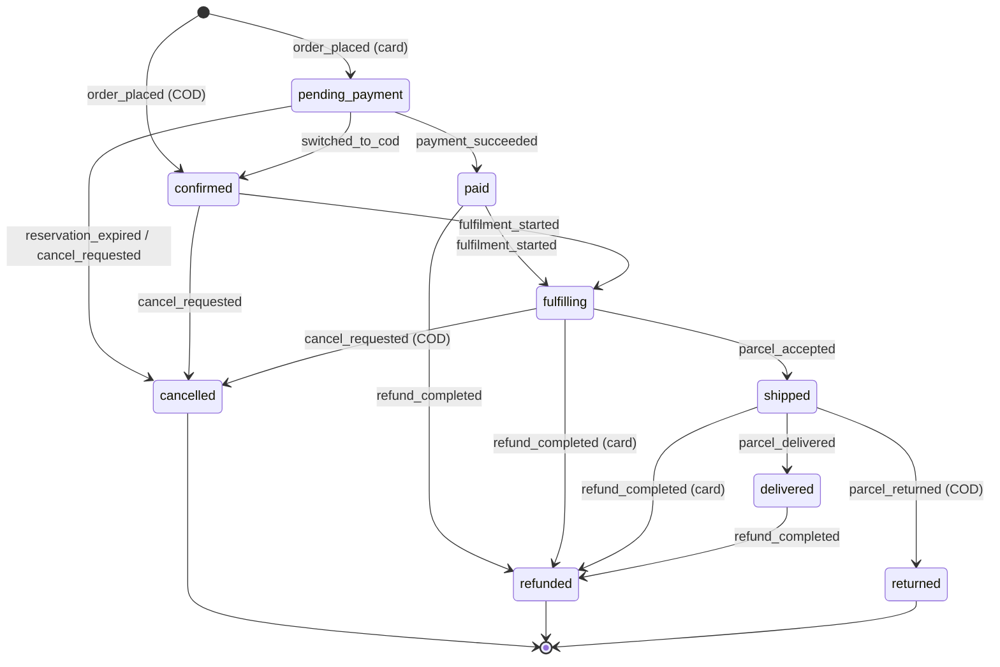

# 0011. Order state machine

- Status: Accepted
- Date: 2026-11-27

## Context

An order's status decides what the shop may do next: take payment, ship, refund, cancel.
Several actors change it: the customer, staff, verified payment webhooks, the payment
reconciliation job, the reservation expiry job and the shipment tracking job. They can act
concurrently, and some of their inputs arrive late or twice. Card and cash-on-delivery (COD)
orders follow different paths. A status changed from the wrong place, or in the wrong order,
means shipping unpaid goods, cancelling a paid order or charging a customer twice.

The project brief sketched a diagram (section 6) that left gaps: a failed payment cancelled
the order, although CLAUDE.md requires that the customer can retry; there was no path for
switching to COD; a card parcel the customer never collects had no outcome; and the first COD
state, `awaiting_shipment`, came before `fulfilling`, which made its name misleading.

## Decision

The order status changes only through one transition function in the orders module,
`transition(order, event)`, which returns the new state or a typed error. No other code
writes `orders.status`.

### States

| State | Meaning | Terminal |
|---|---|---|
| `pending_payment` | Card order placed, stock reserved, waiting for a verified payment. | no |
| `confirmed` | COD order placed (or a card order switched to COD), stock reserved. | no |
| `paid` | Card payment confirmed by a verified webhook or reconciliation. | no |
| `fulfilling` | Staff are picking and packing. | no |
| `shipped` | The carrier has accepted the parcel. | no |
| `delivered` | The customer collected the parcel. | no, see below |
| `cancelled` | Stopped before shipping; no money is held. | yes |
| `refunded` | All money returned, confirmed by the payment side. | yes |
| `returned` | COD parcel not collected and back with us. | yes |

`delivered` is the normal end of an order but not terminal: a return within the legal
period can still lead to `refunded`.

### Transitions

| From | Event | To | Actor | Guard |
|---|---|---|---|---|
| (new) | `order_placed` | `pending_payment` | customer | card payment; stock reserved |
| (new) | `order_placed` | `confirmed` | customer | COD; stock reserved; COD limits pass |
| `pending_payment` | `payment_succeeded` | `paid` | verified webhook, reconciliation job | amount and currency match the order |
| `pending_payment` | `switched_to_cod` | `confirmed` | customer | no payment attempt in progress or succeeded; COD limits pass |
| `pending_payment` | `reservation_expired` | `cancelled` | reservation expiry job | reservation still unpaid |
| `pending_payment` | `cancel_requested` | `cancelled` | customer, staff | no payment attempt in progress or succeeded |
| `paid`, `confirmed` | `fulfilment_started` | `fulfilling` | staff | none |
| `confirmed` | `cancel_requested` | `cancelled` | customer, staff | none |
| `fulfilling` | `cancel_requested` | `cancelled` | staff | COD only |
| `fulfilling` | `parcel_accepted` | `shipped` | tracking job, staff | a shipment exists for the order |
| `shipped` | `parcel_delivered` | `delivered` | tracking job | none |
| `shipped` | `parcel_returned` | `returned` | tracking job, staff | COD only |
| `paid`, `fulfilling`, `shipped`, `delivered` | `refund_completed` | `refunded` | payments module | full amount refunded; card only from `fulfilling` and `shipped` |

Every event not listed for a state is rejected with a typed error naming the state and the
event. Each successful transition writes a row to `order_status_history` and an outbox event
(`order.<new_state>`, for example `order.paid`) in the same transaction. Consumers of those
events (receipts, emails, stock changes, waybills) are defined in the phases that build them.

### Rules

- **A failed payment is not a transition.** The payments module records the failed attempt;
  the order stays `pending_payment` so the customer can retry with the same card, use another
  card, or switch to COD. Nothing retries a customer payment automatically.
- **A card order is cancelled only by reservation expiry or an explicit cancel.** The payment
  invoice lifetime is shorter than the reservation lifetime, so a payment rarely completes
  after its order is cancelled.
- **A late `payment_succeeded` on a `cancelled` order is rejected** by the order machine. The
  payments module records the payment and returns the money; the mechanism (cancelling a hold
  or a refund, and the fiscal receipts involved) is decided in the payments ADR in Phase 3.
- **`refunded` means the refund is confirmed**, not requested. While a refund is pending the
  order keeps its current state; the refund's own status lives in the payments module. For
  COD orders the refund is a bank transfer that staff confirm.
- **v1 supports full refunds only.** A partial refund would not change the order state and is
  out of scope until needed.
- **A card parcel the customer never collects** stays `shipped` (the shipment's own status
  shows it returning) until the money is refunded, then becomes `refunded`. `returned` is
  for COD only, because no money was taken.
- **`shipped` means the carrier has the parcel.** Creating a Nova Poshta waybill does not
  move the order; the tracking job (or staff) does once the carrier accepts the parcel.
- **Concurrent transitions are compare-and-set:** `UPDATE orders SET status = :to ... WHERE
  id = :id AND status = :from`. Zero updated rows means another actor won; the caller reloads
  and re-evaluates. Duplicate webhooks and job retries are therefore harmless.
- **The database enforces the state set:** `orders.status` is `text` with a `CHECK` listing
  exactly these states, and a test asserts that the `CHECK` and the code agree.

## Consequences

- One function and one table answer "can this happen now?", so the rule is unit-testable
  without a database (Phase 1c) and auditable from `order_status_history`.
- Customers keep their order and reservation through a failed payment, at the cost of stock
  staying reserved until the reservation expires.
- Refund timing is explicit: an order is never shown as refunded before the money moves.
- Adding a state (for example `partially_refunded` or a phone-verification step for COD)
  means a new migration for the `CHECK`, a code change, and a new ADR.

## Alternatives considered

- **Postgres `ENUM` type for the status:** values cannot be removed or reordered without
  rewriting the type, and migrations get awkward. `text` with a `CHECK` gives the same
  guarantee and changes with an ordinary migration.
- **A state-machine library (XState or similar):** adds a dependency and a runtime model for
  what is a small static table. A plain typed transition table is easier to read and review.
- **Separate flags (`is_paid`, `is_shipped`, `is_cancelled`):** allow impossible combinations
  such as cancelled and shipped, and leave the order's lifecycle implicit.
- **Cancelling the order on a failed payment (the brief's first draft):** simpler, but it
  breaks the rule that the customer decides whether to retry, and loses their reservation.
