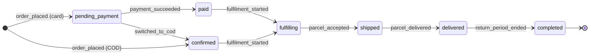
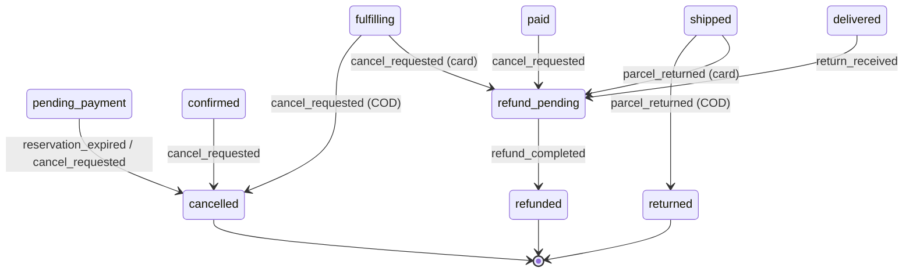

# 0011. Order state machine

- Status: Accepted
- Date: 2026-11-27

## Context

An order's status decides what the shop may do next: take payment, ship, refund, cancel.
Several actors change it: the customer, staff, verified payment webhooks, the payment
reconciliation job, the reservation expiry job and the shipment tracking job. They can act
concurrently, and some of their inputs arrive late or twice. Card and cash-on-delivery (COD)
orders follow different paths. A status changed from the wrong place, or in the wrong order,
means shipping unpaid goods, cancelling a paid order or charging a customer twice.

The project brief sketched a diagram (section 6) that left gaps: a failed payment cancelled
the order, although CLAUDE.md requires that the customer can retry; there was no path for
switching to COD; a card parcel the customer never collects had no outcome; a successful order never reached
an end state, so refunds looked like the next step after delivery; and the first COD
state, `awaiting_shipment`, came before `fulfilling`, which made its name misleading.

## Decision

The order status changes only through one transition function in the orders module,
`transition(order, event)`, which returns the new state or a typed error. No other code
writes `orders.status`.

### States

States on the main flow, in the order a successful order passes through them:

| State | Meaning | Terminal |
|---|---|---|
| `pending_payment` | Card order placed, stock reserved, waiting for a verified payment. | no |
| `confirmed` | COD order placed (or a card order switched to COD), stock reserved. | no |
| `paid` | Card payment confirmed by a verified webhook or reconciliation. | no |
| `fulfilling` | Staff are picking and packing. | no |
| `shipped` | The carrier has accepted the parcel. | no |
| `delivered` | The customer collected the parcel; the return period is running. | no |
| `completed` | The return period has ended. The order is closed. | yes, the normal outcome |

States used only when an order does not complete:

| State | Meaning | Terminal |
|---|---|---|
| `refund_pending` | The order is stopped and its money is being returned. | no |
| `cancelled` | Stopped before shipping; no money is held. | yes |
| `refunded` | All money returned, confirmed by the payment side. | yes |
| `returned` | COD parcel not collected and back with us. | yes |

### Main flow

Almost every order follows this path. A card order waits for payment; a COD order skips it,
and a card order whose customer switches to COD joins the COD path.

### Exceptions

Cancellations, uncollected parcels and returns. Every path that returns money goes through
`refund_pending`.

### Transition table

The complete list; the code in the orders module implements exactly this table.

| From | Event | To | Actor | Guard |
|---|---|---|---|---|
| (new) | `order_placed` | `pending_payment` | customer | card payment; stock reserved |
| (new) | `order_placed` | `confirmed` | customer | COD; stock reserved; COD limits pass |
| `pending_payment` | `payment_succeeded` | `paid` | verified webhook, reconciliation job | amount and currency match the order |
| `pending_payment` | `switched_to_cod` | `confirmed` | customer | no payment attempt in progress or succeeded; COD limits pass |
| `paid`, `confirmed` | `fulfilment_started` | `fulfilling` | staff | none |
| `fulfilling` | `parcel_accepted` | `shipped` | tracking job, staff | a shipment exists for the order |
| `shipped` | `parcel_delivered` | `delivered` | tracking job | none |
| `delivered` | `return_period_ended` | `completed` | order completion job | the return period since delivery has passed |
| `pending_payment` | `reservation_expired` | `cancelled` | reservation expiry job | reservation still unpaid |
| `pending_payment` | `cancel_requested` | `cancelled` | customer, staff | no payment attempt in progress or succeeded |
| `confirmed` | `cancel_requested` | `cancelled` | customer, staff | none |
| `fulfilling` | `cancel_requested` | `cancelled` | staff | COD only |
| `shipped` | `parcel_returned` | `returned` | tracking job, staff | COD only |
| `paid` | `cancel_requested` | `refund_pending` | customer, staff | none |
| `fulfilling` | `cancel_requested` | `refund_pending` | staff | card only |
| `shipped` | `parcel_returned` | `refund_pending` | tracking job, staff | card only; the parcel is back with us |
| `delivered` | `return_received` | `refund_pending` | staff | the returned goods arrived, within the return period |
| `refund_pending` | `refund_completed` | `refunded` | payments module | the full amount is refunded |

Every event not listed for a state is rejected with a typed error naming the state and the
event. Each successful transition writes a row to `order_status_history` and an outbox event
(`order.<new_state>`, for example `order.paid`) in the same transaction. Consumers of those
events (receipts, emails, stock changes, waybills) are defined in the phases that build them.

### Rules

- **A failed payment is not a transition.** The payments module records the failed attempt;
  the order stays `pending_payment` so the customer can retry with the same card, use another
  card, or switch to COD. Nothing retries a customer payment automatically.
- **A card order is cancelled only by reservation expiry or an explicit cancel.** The payment
  invoice lifetime is shorter than the reservation lifetime, so a payment rarely completes
  after its order is cancelled.
- **A late `payment_succeeded` on a `cancelled` order is rejected** by the order machine. The
  payments module records the payment and returns the money; the mechanism (cancelling a hold
  or a refund, and the fiscal receipts involved) is decided in the payments ADR in Phase 3.
- **A refund starts with a state change.** Every path to `refunded` goes through
  `refund_pending`, which accepts no fulfilment or shipping events, so an order cannot be
  packed or shipped while its money is being returned. Entering `refund_pending` writes
  `order.refund_pending`, and the payments module creates the refund from it (a queued job
  for card payments; for COD a bank transfer that staff confirm).
- **`refunded` means the refund is confirmed**, not requested: only `refund_completed` from
  the payments module leaves `refund_pending`. A refund that fails is retried by its job with
  bounded backoff and stays visible to staff; the order stays `refund_pending` and never
  goes back to an earlier state.
- **An order completes when its return period ends.** A scheduled job applies
  `return_period_ended` to orders `delivered` longer than the return period (a config value,
  14 days by default, matching the consumer return period under Ukrainian law; to be
  confirmed with the accountant). Staff may register a return (`return_received`) only
  while the order is `delivered`; goods announced for return in time but arriving after
  completion are handled as the exception below. Reports treat `completed` as final revenue.
- **A completed order is never reopened.** A later refund (for example a warranty claim on a
  defective item) is a staff-only exception: the payments module records the refund and its
  return receipt, and the order stays `completed`.
- **v1 supports full refunds only.** A partial refund would not change the order state and is
  out of scope until needed.
- **A card parcel the customer never collects** stays `shipped` (the shipment's own status
  shows it returning) until it is back with us, then goes to `refund_pending`. `returned` is
  for COD only, because no money was taken.
- **The order status tracks the goods, not the money.** Payment and settlement live in the
  payments module, as most commerce platforms separate order and payment status. For COD,
  `delivered` means the customer has paid the carrier, because the parcel is not handed
  over otherwise. Whether the carrier has passed the cash on to us is tracked on the COD
  payment and reconciled there; it adds no order state, and `completed` does not wait for it.
- **`shipped` means the carrier has the parcel.** Creating a Nova Poshta waybill does not
  move the order; the tracking job (or staff) does once the carrier accepts the parcel.
- **Concurrent transitions are compare-and-set:** `UPDATE orders SET status = :to ... WHERE
  id = :id AND status = :from`. Zero updated rows means another actor won; the caller reloads
  and re-evaluates. Duplicate webhooks and job retries are therefore harmless.
- **The database enforces the state set:** `orders.status` is `text` with a `CHECK` listing
  exactly these states, and a test asserts that the `CHECK` and the code agree.

## Consequences

- A successful order ends in `completed`; cancellations, returns and refunds are side
  branches drawn separately, so the main flow reads on its own.
- One function and one table answer "can this happen now?", so the rule is unit-testable
  without a database (Phase 1c) and auditable from `order_status_history`.
- Customers keep their order and reservation through a failed payment, at the cost of stock
  staying reserved until the reservation expires.
- Refund timing is explicit: an order is never shown as refunded before the money moves.
- Adding a state (for example `partially_refunded` or a phone-verification step for COD)
  means a new migration for the `CHECK`, a code change, and a new ADR.

## Alternatives considered

- **Postgres `ENUM` type for the status:** values cannot be removed or reordered without
  rewriting the type, and migrations get awkward. `text` with a `CHECK` gives the same
  guarantee and changes with an ordinary migration.
- **A state-machine library (XState or similar):** adds a dependency and a runtime model for
  what is a small static table. A plain typed transition table is easier to read and review.
- **Separate flags (`is_paid`, `is_shipped`, `is_cancelled`):** allow impossible combinations
  such as cancelled and shipped, and leave the order's lifecycle implicit.
- **Refunding without a pending state** (the order keeps its state until the refund is
  confirmed, guarded by "no open refund" on fulfilment and shipping events): fewer states,
  but the order machine would depend on refund data held by payments, and an order being
  refunded would not show as such in its status or history.
- **Cancelling the order on a failed payment (the brief's first draft):** simpler, but it
  breaks the rule that the customer decides whether to retry, and loses their reservation.
