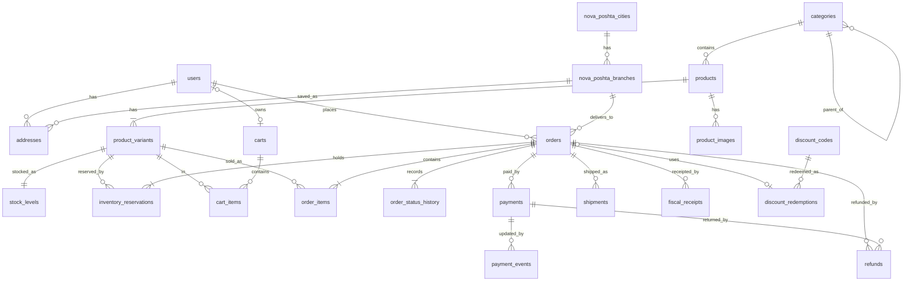
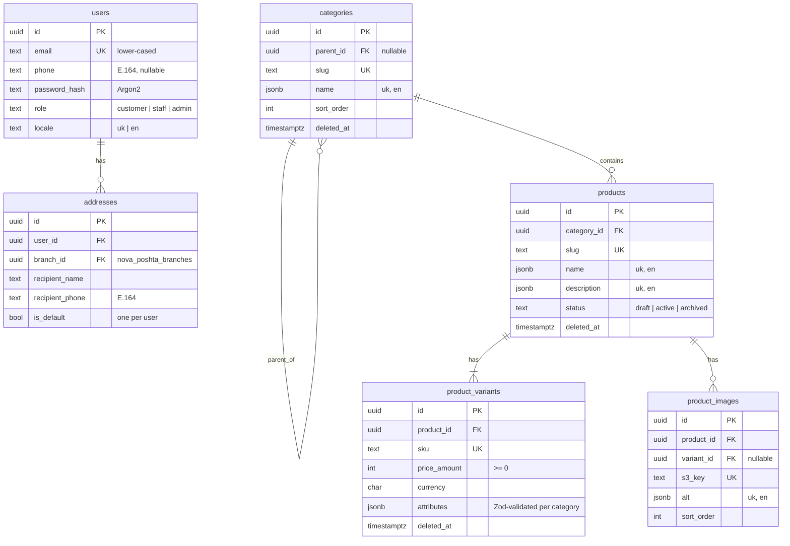
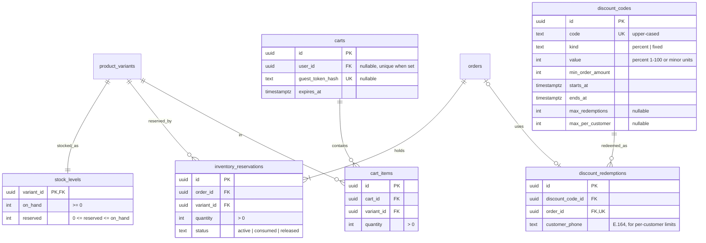
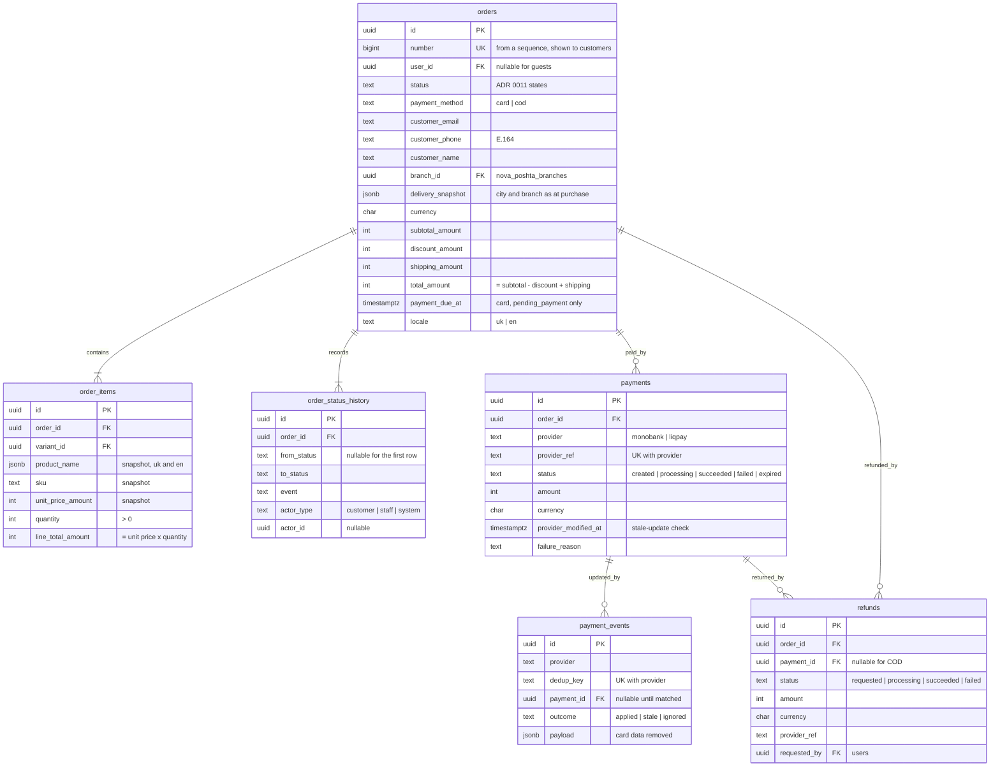
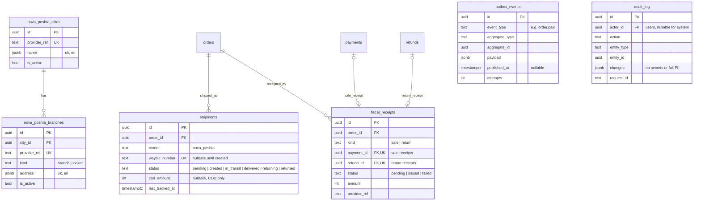
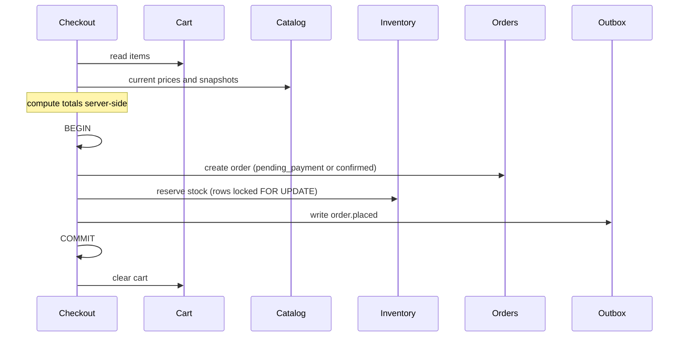

# Architecture: domain model

How the shop's data is divided between API modules, how the tables relate, and how modules
talk to each other. The system overview is in `PROJECT_BRIEF.md` (section 3); the order
lifecycle is in [ADR 0011](adr/0011-order-state-machine.md).

This file is the design. Once a module's tables exist, its Drizzle schema in `apps/api` is
the source of truth, and any PR that changes the schema updates this file in the same PR.

## Scope

The ERD covers the whole domain, but each module's tables are created in the phase that
first uses them, because untested tables tend to be designed wrong:

| Phase | Tables |
|---|---|
| 1 | catalog, orders, inventory |
| 2 | users, audit_log |
| 3 | carts, payments, outbox_events |
| 4 | discounts, refunds, shipping, fiscalization |

Columns that depend on a provider's API (monobank, LiqPay, Checkbox, Nova Poshta) are
generic here (`provider_ref`, `dedup_key`) and are defined when the provider's docs are
added to `docs/vendor/`.

## Table ownership

A module never reads or writes another module's tables (ADR 0001). It calls that module's
exported service, which may take the caller's transaction, or reacts to its events.

| Module | Tables |
|---|---|
| users | `users`, `addresses` |
| catalog | `categories`, `products`, `product_variants`, `product_images` |
| inventory | `stock_levels`, `inventory_reservations` |
| cart | `carts`, `cart_items` |
| checkout | `discount_codes`, `discount_redemptions` |
| orders | `orders`, `order_items`, `order_status_history` |
| payments | `payments`, `payment_events`, `refunds` |
| shipping | `shipments`, `nova_poshta_cities`, `nova_poshta_branches` |
| fiscalization | `fiscal_receipts` |
| notifications | none yet |
| platform (shared infrastructure) | `outbox_events`, `audit_log` |

- **Sessions** live in Redis (`session:{id}`), not Postgres; the Phase 2 auth ADR settles
  the details.
- **Stock** belongs to inventory, not to `product_variants`, so checkout can lock and change
  it without writing catalog tables.
- **Checkout** orchestrates cart, inventory, orders and payments; the only tables it owns
  are for discount codes.
- **Platform tables** are written through `OutboxService` and `AuditService`, inside the
  calling module's transaction.

## Conventions

- `id uuid PRIMARY KEY DEFAULT uuidv7()` (Postgres 18). Code may pass its own UUIDv7.
- Every table has `created_at` and `updated_at` (`timestamptz NOT NULL`); `updated_at` is set
  by Drizzle's `$onUpdate`. They are left out of the diagrams below.
- Money: `<name>_amount integer` in minor units with `CHECK (<name>_amount >= 0)`, and
  `currency char(3) NOT NULL DEFAULT 'UAH'`. An order has one currency; its rows use it.
- Statuses and kinds: `text` with a `CHECK` listing the allowed values, not Postgres enums.
- Soft delete: `deleted_at timestamptz` on catalog tables. Rows other tables refer to are
  never hard-deleted.
- Translatable text: `jsonb` `{ "uk": "...", "en": "..." }`, `uk` required, validated with Zod.
- Phones in E.164 (`+380...`). Emails stored lower-cased.

## Overview

`outbox_events` and `audit_log` refer to rows of any module by type and ID, without foreign
keys, so they are not drawn.

## Users and catalog

## Inventory, cart and checkout

## Orders and payments

## Shipping, fiscalization and platform

## Key constraints

Rules that must always hold are enforced by the database, not only in code (ADR 0004).

- **Foreign keys, including between modules,** with `ON DELETE RESTRICT`, and an index on
  every foreign key. One database makes them cheap; extracting a module later means dropping
  the ones that cross its boundary.
- **Stock:** `CHECK (on_hand >= 0)`, `CHECK (reserved >= 0 AND reserved <= on_hand)`.
  Reservations change `reserved` inside the same transaction, with the `stock_levels` row
  locked `FOR UPDATE`.
- **Quantities:** `CHECK (quantity > 0)` on reservations, cart items and order items.
  `UNIQUE (order_id, variant_id)` on reservations and `UNIQUE (cart_id, variant_id)` on cart
  items.
- **Order totals:** `CHECK (total_amount = subtotal_amount - discount_amount +
  shipping_amount)` and `CHECK (line_total_amount = unit_price_amount * quantity)`.
  `payment_due_at` is set only for card orders.
- **Statuses:** a `CHECK` on every status column; for `orders.status` a test asserts it
  matches the state machine in code.
- **Payments:** `UNIQUE (provider, provider_ref)`; a partial unique index allows at most one
  `succeeded` payment per order.
- **Webhooks:** `UNIQUE (provider, dedup_key)` on `payment_events`, so a duplicate webhook
  fails the insert and is skipped.
- **Refunds:** full refunds only in v1, so a partial unique index allows one refund per order
  that is not `failed`.
- **Fiscal receipts:** a `CHECK` that a sale receipt has `payment_id` and no `refund_id`, and
  a return receipt the opposite; the unique keys give one receipt per payment and per refund.
- **Carts:** one cart per user (`UNIQUE (user_id)`), and a guest cart is found by the hash of
  its cookie token, never the token itself.
- **Catalog:** `sku` and slugs are unique among all rows, deleted ones included, so an old
  order's SKU never points to a different product.
- **Nova Poshta directory:** the nightly sync marks branches and cities inactive instead of
  deleting them, so saved addresses and old orders keep their references.

## How modules communicate

### Placing an order

Checkout runs the steps that must succeed or fail together in one transaction, through
other modules' exported services:

For a card order, checkout then asks payments to create an invoice directly, because the
customer is waiting for the payment link. Payment status changes only from verified webhooks
or the reconciliation job.

### Payment confirmation

The webhook handler verifies the signature, records the payment status and applies
`payment_succeeded` through the orders service, all in one transaction, then writes outbox
events and responds. It calls no external service. Doing the order transition in the same
transaction, not through an event, keeps the window for a late payment as small as possible.

### Reservation expiry

The expiry job in the orders module finds card orders in `pending_payment` whose
`payment_due_at` has passed. For each it applies `reservation_expired` with compare-and-set
(ADR 0011) and, in the same transaction, calls inventory to release the reservations. A
payment webhook and the job therefore cannot both win: whichever changes the status first
decides, and the loser sees zero updated rows.

### Domain events

Each state change writes an outbox event in the same transaction. A publisher moves them to
BullMQ; consumers are idempotent.

| Event | Producer | Consumers |
|---|---|---|
| `order.placed` | orders | notifications (confirmation email) |
| `order.paid` | orders | fiscalization (sale receipt), notifications |
| `order.cancelled` | orders | notifications |
| `order.shipped`, `order.delivered`, `order.returned` | orders | notifications; inventory (stock back on `returned`) |
| `order.completed` | orders | none yet (reports and review requests later) |
| `order.refund_pending` | orders | payments (creates the refund); inventory (releases the reservation, or returns stock if the goods came back) |
| `order.refunded` | orders | notifications |
| `payment.succeeded`, `payment.failed` | payments | notifications |
| `refund.succeeded` | payments | orders (applies `refund_completed`), fiscalization (return receipt) |
| `shipment.accepted`, `shipment.delivered`, `shipment.returned` | shipping | orders (applies the parcel events), inventory (consumes reservations on accepted) |

The exact list grows with the phases that build each consumer.
